# cydOS (`v1.1`)

An **Android-inspired Material 3** OS for the *ESP32 Cheap Yellow Display*.

https://github.com/user-attachments/assets/2e78e59f-e912-49e2-bb66-1ce1483235f8

Runs on `ESP32-2432S028` boards with **LVGL 8.4** and **PlatformIO**.

## Contents

- [Live Demo](#live-demo)
- **UI & Navigation**
  - [Home Screen (Dark & Light)](#home-screen-dark--light)
  - [Tap-Arrow App Pages](#tap-arrow-app-pages)
  - [Quick Settings Shade](#quick-settings-shade)
  - [Bottom Menu Popup](#bottom-menu-popup)
  - [Material 3 Modals](#material-3-modals)
  - [On-Screen Keyboard](#on-screen-keyboard)
- **Apps**
  - [App Store (WIP)](#app-store-wip)
  - [Files](#files)
  - [Gallery](#gallery)
  - [Terminal](#terminal)
  - [Wi-Fi Manager](#wi-fi-manager)
  - [Bluetooth BLE Scanner](#bluetooth-ble-scanner)
  - [BLE Trackpad & Remote](#ble-trackpad--remote)
  - [Screen Mirror](#screen-mirror)
  - [WhatsApp Companion](#whatsapp-companion)
  - [Android Link](#android-link)
  - [Calculator](#calculator)
  - [About](#about)
  - [Web Browser](#web-browser)
  - [Music](#music)
  - [Notes](#notes)
  - [Settings](#settings)
  - [Clock](#clock)
  - [SqLine Lab](#sqline-lab)
  - [EEZ Studio](#eez-studio)
  - [System Info](#system-info)
- **Setup & Development**
  - [Supported Hardware](#supported-hardware)
  - [Quick Start](#quick-start)
  - [Android Companion](#android-companion)
  - [How to Add a New App to cydOS](#how-to-add-a-new-app-to-cydos)
- [LLM Context](#llm-context)

---

## Live Demo

| Navigation & Quick Settings | Bluetooth & Wi-Fi Scan | Browser & Keyboard |
| :---: | :---: | :---: |
| 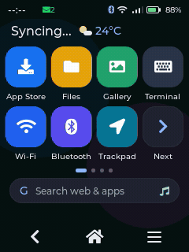 | 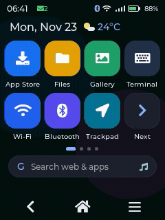 | 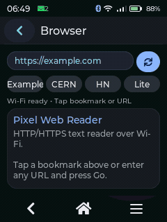 |

- Real hardware captures from `ESP32-2432S028` (`cyd2usb`).

## Home Screen (Dark & Light)

| Dark Mode | Light Mode |
| :---: | :---: |
| 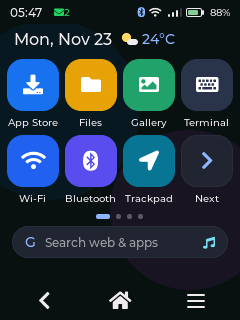 |  |

- Switch between **Dark**, **Light**, and *AMOLED Black* themes live.
- Shows date, weather, `4×2` app grid, and search bar.
- Persistent 3-button Android navigation bar sits at the bottom.
- *Note*: Top-bar cell signal bars are just for show.


## Tap-Arrow App Pages

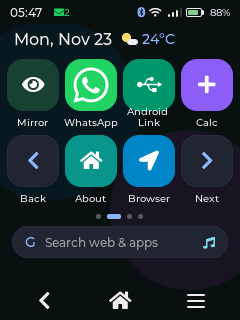

- Tap **`Next`** (8th slot) to open the next page.
- Tap **`Back`** (5th slot) to return to earlier apps.
- <mark>No hard resistive-screen swiping</mark> required to browse apps.

## Quick Settings Shade


- Pull down from the top status bar to open.
- Toggle **Wi-Fi**, **Bluetooth**, **Airplane**, and **Torch** quickly.
- Adjust screen brightness, **Reboot**, or **Shutdown** in one tap.

## Bottom Menu Popup


- Tap the bottom-right **3-line button** anywhere in cydOS.
- Jump straight to Quick Settings, Theme, Settings, or Sys Info.
- Tap **Close App** to return home cleanly.

## Material 3 Modals


- Reusable `m3_modal` dialogs with dimmed backdrop and rounded corners.
- Supports action buttons, multi-step guides, and animated progress bars.

## On-Screen Keyboard

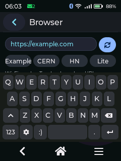

- Slide your finger across keys with a live floating preview.
- Includes `ABC` and `123` layouts with Dark and Light themes.

---

## App Store (WIP)


- <mark>Work in progress — not working yet.</mark>
- Goal: embed [`m5launcher`](https://github.com/bmorcelli/Launcher) by **bmorcelli** inside cydOS.
- Planned OTA and SD `.bin` app installer with dynamic partitions.

## Files

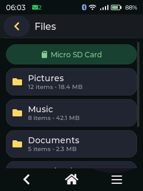

- Browse internal flash or an optional **VSPI microSD** card.
- Inspect file sizes, navigate folders, or format cards to `FAT32`.

## Gallery

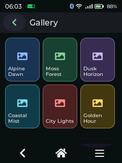

- Simple built-in image and color swatch viewer for the display.

## Terminal

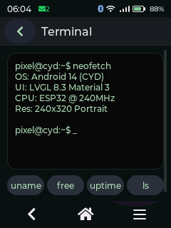

- Compact system console showing device status and quick diagnostic output.

## Wi-Fi Manager


- Scans nearby *2.4 GHz* Wi-Fi networks asynchronously.
- Enter passwords with the slide-to-select on-screen keyboard.
- Saves credentials to ESP32 NVS for automatic boot reconnect.

## Bluetooth BLE Scanner


- Powered by lazy-initialized `NimBLE-Arduino` for low RAM use.
- Lists nearby BLE device names, MAC addresses, and RSSI.

## BLE Trackpad & Remote


- Works as a *Bluetooth HID* mouse and media remote.
- Switch between **Pad** mode (with scroll strip) and **Remote** mode.
- *Proof of concept*: Works, but not yet smooth or optimized.
- *Planned*: Larger trackpad area with extra buttons in 1–2 popout menus.

## Screen Mirror

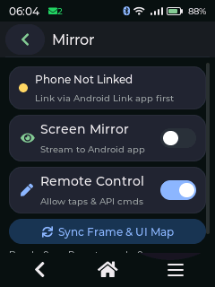

- Streams compressed RGB565 screen bands to the Android companion app.
- Accepts live remote touch input and programmatic UI commands.

## WhatsApp Companion

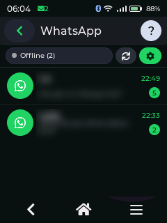

- Local Wi-Fi WebSocket bridge to the **Android Companion** app.
- Read incoming notifications and send quick replies without cloud servers.

## Android Link

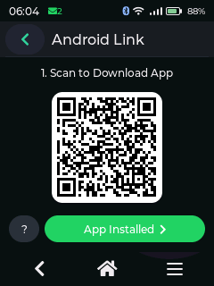

- One-tap **QR code** setup for the Android companion app.
- Step 1 downloads the APK; Step 2 pairs over Wi-Fi.

## Calculator

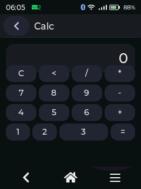

- Clean Material 3 pocket calculator with large touch-friendly buttons.

## About

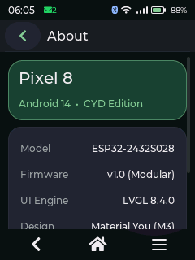

- Quick overview of cydOS version, display, and core features.

## Web Browser

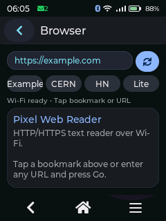

- Async HTTP and HTTPS text reader over Wi-Fi.
- Follows redirects, strips HTML cleanly, and supports bookmarks.

## Music

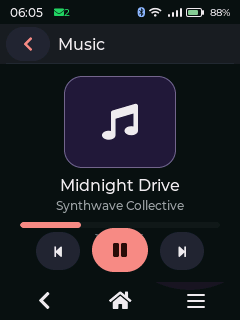

- Compact Material 3 media player interface with transport controls.

## Notes

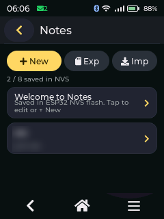

- Saves up to 8 notes in persistent ESP32 NVS flash.
- Supports optional microSD export and import (`/pixel_notes.txt`).

## Settings

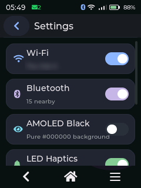

- Toggle **Wi-Fi**, **Bluetooth**, **AMOLED Black**, and **LED Haptics**.
- Recalibrate resistive touch or tune tap sensitivity anytime.

## Clock

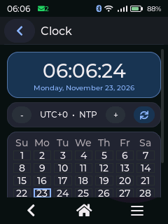

- Syncs time automatically via **NTP** over Wi-Fi.
- Includes saved UTC timezone offset and a live monthly calendar.

## SqLine Lab

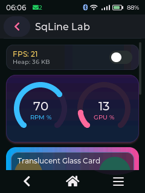

- Visual-limits benchmark with gradients, radial arcs, charts, and FPS HUD.

## EEZ Studio

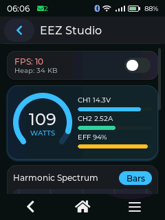

- HMI benchmark with gauges, live bars, font ladder, and stress grid.

## System Info


- Shows live ESP32 chip model, CPU speed, and flash size.
- Tracks current free heap and minimum free heap block.

---

## Supported Hardware

| Dual-USB CYD (`cyd2usb`) | Classic CYD (`cyd`) |
| :---: | :---: |
| 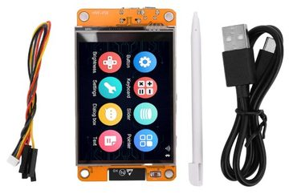 | 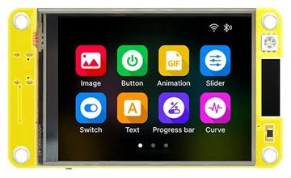 |

- **Dual-USB CYD (`cyd2usb`)**: *Default target.* Uses `ST7789` display and `GPIO 27` backlight.
  - Has a bottom-middle USB-C port, micro-USB beside it, and white 4-pin port.
- **Classic CYD (`cyd`)**: Single-USB board. Uses `ILI9341` display and `GPIO 21` backlight.
- **Touch**: `XPT2046` resistive touch with light-tap tuning and noise filtering.
- **MicroSD**: Optional VSPI card slot for apps, files, and backups.

## Quick Start

Copy and paste the prompt below to have your LLM install cydOS:

```text
Clone https://github.com/fp101fs/cydOS and install PlatformIO if needed.
Detect my connected ESP32 Cheap Yellow Display (CYD) USB serial port.
Ask whether my board is Dual-USB (cyd2usb, default) or Classic (cyd).
Build and flash cydOS with `pio run -e <env> -t upload`.
Verify the flash succeeded and report any serial boot errors.
```

<u>Install PlatformIO</u> before building manually:

```bash
# Build both boards
pio run -e cyd2usb -e cyd

# Verify partition layout
python3 tools/verify_partitions.py

# Flash Dual-USB CYD (default)
pio run -e cyd2usb -t upload

# Flash Classic CYD
pio run -e cyd -t upload
```

Hold **BOOT** during reset to recalibrate touch.

## Android Companion

**Read WhatsApp notifications on CYD!** This totally works and is tested.

UI needs polishing, but the proof of concept is good to go.

Pairing Android takes a few tricks. Check the companion app's info modals.

The companion app lives in `android-companion/`.

1. Open **Android Link** on your CYD.
2. Scan the QR code to install the companion APK.
3. Grant **Notification Access** on your phone.
4. Join the same *2.4 GHz Wi-Fi* network.
5. Scan the pairing QR code to connect.

## How to Add a New App to cydOS

Create one file at `src/apps/app_mytool.cpp`:

```cpp
#include "app_registry.h"
#include "../components/m3_widgets.h"

static void buildMyTool(lv_obj_t* body) {
    lv_obj_t* lbl = lv_label_create(body);
    lv_label_set_text(lbl, "Hello CYD!");
}

REGISTER_APP(mytool, "mytool", "My Tool", LV_SYMBOL_OK,
             0x8AB4F8, 0x1D3557, buildMyTool, nullptr, 170);
```

Rebuild and flash. No core UI edits are needed.

---

## LLM Context

<u>This section is Machine-readable summary for AI coding assistants.</u>

### Stack & Targets
- **MCU**: ESP32-WROOM-32, 4 MB flash, 320 KB RAM, no PSRAM.
- **Framework**: PlatformIO Arduino, `LVGL 8.4` (`LV_MEM_CUSTOM 1`), `TFT_eSPI`, `NimBLE-Arduino`.
- **Environments**: `cyd2usb` (`ST7789`, default), `cyd` (`ILI9341`).
- **Companion**: Kotlin Jetpack Compose Android app in `android-companion/`.

### Flash Partition Map (`partitions_launcher_4mb.csv`)
- `nvs` (`0x009000`, 20 KB): Settings, Wi-Fi, notes, WhatsApp, App Store registry.
- `otadata` (`0x00E000`, 8 KB): Boot slot selector (`factory` vs installed app).
- `factory` (`0x010000`, 2.00 MB): Main cydOS firmware (~97.6% full).
- **Dynamic Pool** (`0x210000..0x400000`, 1.94 MB): Runtime-managed installed apps and data.

### Key Directories
- `src/apps/`: 21 modular apps (`app_store` WIP, `app_whatsapp`, `app_trackpad`, `app_screen_mirror`, etc.).
- `src/launcher/`: Dynamic partitioner, LauncherHub OTA, SD flasher, backup, WebUI (WIP).
- `src/drivers/`: Display, touch, Wi-Fi, NTP, HTTP, BLE, HID, WebSocket, mirror.
- `src/components/`: Shared Material 3 widgets, `m3_modal`, and keyboard.
- `src/ui/` & `src/theme/`: Home grid (arrow pagination), status bar, nav bar, themes.
- `tools/`: Host C++ tests, `verify_partitions.py`, and `capture_screenshot.py`.

### Critical Constraints
- **DRAM Budget**: Heap is tight during HTTPS TLS (~77 KB free).
- **TLS Safety**: Free Explore cards before HTTPS calls. Release Classic BT DRAM.
- **Stack Size**: `loopTask` uses a 12 KB stack for TLS calls.
- **Touch Pins**: `CLK=25`, `MOSI=32`, `MISO=39`, `CS=33`, `IRQ=36`.
- **SD Pins (VSPI)**: `SCK=18`, `MISO=19`, `MOSI=23`, `CS=5`.
- **Companion Protocol**: RFC 6455 WebSocket on `:8765`, pairing endpoint on `:8766`.

### Verification Commands
- **Build**: `pio run -e cyd2usb -e cyd`
- **Partitions**: `python3 tools/verify_partitions.py`
- **Screenshot**: `python3 tools/capture_screenshot.py /dev/cu.usbserial-140 out.png`
- **Companion APK**: Built via `.github/workflows/build-companion-apk.yml`.
