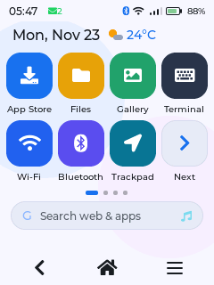
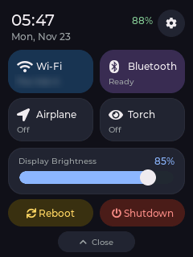
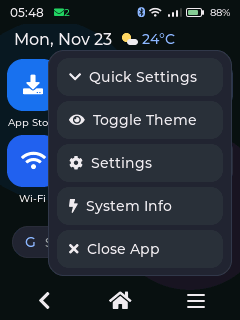
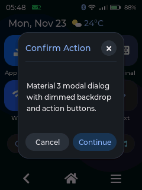
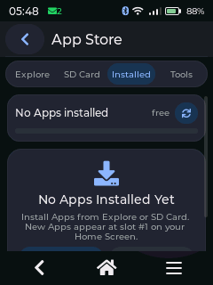
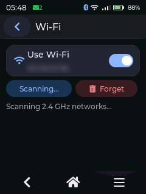
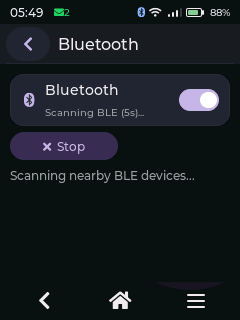
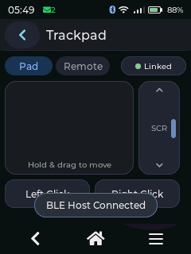
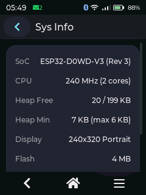

# cydOS (`v1.1`)

An **Android-inspired Material 3** OS for the *ESP32 Cheap Yellow Display*.

Runs on `ESP32-2432S028` boards with **LVGL 8.4** and **PlatformIO**.

## Contents

- [Home Screen (Dark & Light)](#home-screen-dark--light)
- [Tap-Arrow App Pages](#tap-arrow-app-pages)
- [Quick Settings Shade](#quick-settings-shade)
- [Bottom Menu Popup](#bottom-menu-popup)
- [Material 3 Modals](#material-3-modals)
- [App Store](#app-store)
- [Wi-Fi Manager](#wi-fi-manager)
- [Bluetooth BLE Scanner](#bluetooth-ble-scanner)
- [BLE Trackpad & Remote](#ble-trackpad--remote)
- [Settings](#settings)
- [System Info](#system-info)
- [Supported Hardware](#supported-hardware)
- [Quick Start](#quick-start)
- [Android Companion](#android-companion)
- [Add a New App](#add-a-new-app)
- [LLM Context](#llm-context)

---

## Home Screen (Dark & Light)

| Dark Mode | Light Mode |
| :---: | :---: |
|  |  |

- Switch between **Dark**, **Light**, and *AMOLED Black* themes live.
- Shows date, weather, `4×2` app grid, and search bar.
- Persistent 3-button Android navigation bar sits at the bottom.

## Tap-Arrow App Pages


- Tap **`Next`** (8th slot) to open the next page.
- Tap **`Back`** (5th slot) to return to earlier apps.
- <mark>No hard resistive-screen swiping</mark> required to browse apps.

## Quick Settings Shade



- Pull down from the top status bar to open.
- Toggle **Wi-Fi**, **Bluetooth**, **Airplane**, and **Torch** quickly.
- Adjust screen brightness, **Reboot**, or **Shutdown** in one tap.

## Bottom Menu Popup



- Tap the bottom-right **3-line button** anywhere in cydOS.
- Jump straight to Quick Settings, Theme, Settings, or Sys Info.
- Tap **Close App** to return home cleanly.

## Material 3 Modals



- Reusable `m3_modal` dialogs with dimmed backdrop and rounded corners.
- Supports action buttons, multi-step guides, and animated progress bars.

## App Store



- <mark>Install and run ESP32 `.bin` apps</mark> from flash or SD.
- Browse **Explore**, **SD Card**, **Installed**, and **Tools** tabs.
- New apps appear automatically at Home Screen slot `#1`.

## Wi-Fi Manager



- Scans nearby *2.4 GHz* Wi-Fi networks asynchronously.
- Enter passwords with the slide-to-select on-screen keyboard.
- Saves credentials to ESP32 NVS for automatic boot reconnect.

## Bluetooth BLE Scanner



- Powered by lazy-initialized `NimBLE-Arduino` for low RAM use.
- Lists nearby BLE device names, MAC addresses, and RSSI.

## BLE Trackpad & Remote



- Works as a *Bluetooth HID* mouse and media remote.
- Switch between **Pad** mode (with scroll strip) and **Remote** mode.

## Settings


- Toggle **Wi-Fi**, **Bluetooth**, **AMOLED Black**, and **LED Haptics**.
- Recalibrate resistive touch or tune tap sensitivity anytime.

## System Info



- Shows live ESP32 chip model, CPU speed, and flash size.
- Tracks current free heap and minimum free heap block.

---

## Supported Hardware

- **Dual-USB CYD (`cyd2usb`)**: *Default target.* Uses `ST7789` display and `GPIO 27` backlight.
- **Classic CYD (`cyd`)**: Single-USB board. Uses `ILI9341` display and `GPIO 21` backlight.
- **Touch**: `XPT2046` resistive touch with light-tap tuning and noise filtering.
- **MicroSD**: Optional VSPI card slot for apps, files, and backups.

## Quick Start

<u>Install PlatformIO</u> before building the firmware.

```bash
# Build both boards
pio run -e cyd2usb -e cyd

# Verify partition layout
python3 tools/verify_partitions.py

# Flash Dual-USB CYD (default)
pio run -e cyd2usb -t upload

# Flash Classic CYD
pio run -e cyd -t upload
```

Hold **BOOT** during reset to recalibrate touch.

## Android Companion

The companion app lives in `android-companion/`.

1. Open **Android Link** on your CYD.
2. Scan the QR code to install the companion APK.
3. Grant **Notification Access** on your phone.
4. Join the same *2.4 GHz Wi-Fi* network.
5. Scan the pairing QR code to connect.

## Add a New App

Create one file at `src/apps/app_mytool.cpp`:

```cpp
#include "app_registry.h"
#include "../components/m3_widgets.h"

static void buildMyTool(lv_obj_t* body) {
    lv_obj_t* lbl = lv_label_create(body);
    lv_label_set_text(lbl, "Hello CYD!");
}

REGISTER_APP(mytool, "mytool", "My Tool", LV_SYMBOL_OK,
             0x8AB4F8, 0x1D3557, buildMyTool, nullptr, 170);
```

Rebuild and flash. No core UI edits are needed.

---

## LLM Context

<u>Machine-readable summary for AI coding assistants.</u>

### Stack & Targets
- **MCU**: ESP32-WROOM-32, 4 MB flash, 320 KB RAM, no PSRAM.
- **Framework**: PlatformIO Arduino, `LVGL 8.4` (`LV_MEM_CUSTOM 1`), `TFT_eSPI`, `NimBLE-Arduino`.
- **Environments**: `cyd2usb` (`ST7789`, default), `cyd` (`ILI9341`).
- **Companion**: Kotlin Jetpack Compose Android app in `android-companion/`.

### Flash Partition Map (`partitions_launcher_4mb.csv`)
- `nvs` (`0x009000`, 20 KB): Settings, Wi-Fi, notes, WhatsApp, App Store registry.
- `otadata` (`0x00E000`, 8 KB): Boot slot selector (`factory` vs installed app).
- `factory` (`0x010000`, 2.00 MB): Main cydOS firmware (~97.6% full).
- **Dynamic Pool** (`0x210000..0x400000`, 1.94 MB): Runtime-managed installed apps and data.

### Key Directories
- `src/apps/`: 21 modular apps (`app_store`, `app_whatsapp`, `app_trackpad`, `app_screen_mirror`, etc.).
- `src/launcher/`: Dynamic partitioner, LauncherHub OTA, SD flasher, backup, WebUI.
- `src/drivers/`: Display, touch, Wi-Fi, NTP, HTTP, BLE, HID, WebSocket, mirror.
- `src/components/`: Shared Material 3 widgets, `m3_modal`, and keyboard.
- `src/ui/` & `src/theme/`: Home grid (arrow pagination), status bar, nav bar, themes.
- `tools/`: Host C++ tests, `verify_partitions.py`, and `capture_screenshot.py`.

### Critical Constraints
- **DRAM Budget**: Heap is tight during HTTPS TLS (~77 KB free).
- **TLS Safety**: Free Explore cards before HTTPS calls. Release Classic BT DRAM.
- **Stack Size**: `loopTask` uses a 12 KB stack for TLS calls.
- **Touch Pins**: `CLK=25`, `MOSI=32`, `MISO=39`, `CS=33`, `IRQ=36`.
- **SD Pins (VSPI)**: `SCK=18`, `MISO=19`, `MOSI=23`, `CS=5`.
- **Companion Protocol**: RFC 6455 WebSocket on `:8765`, pairing endpoint on `:8766`.

### Verification Commands
- **Build**: `pio run -e cyd2usb -e cyd`
- **Partitions**: `python3 tools/verify_partitions.py`
- **Screenshot**: `python3 tools/capture_screenshot.py /dev/cu.usbserial-140 out.png`
- **Companion APK**: Built via `.github/workflows/build-companion-apk.yml`.
